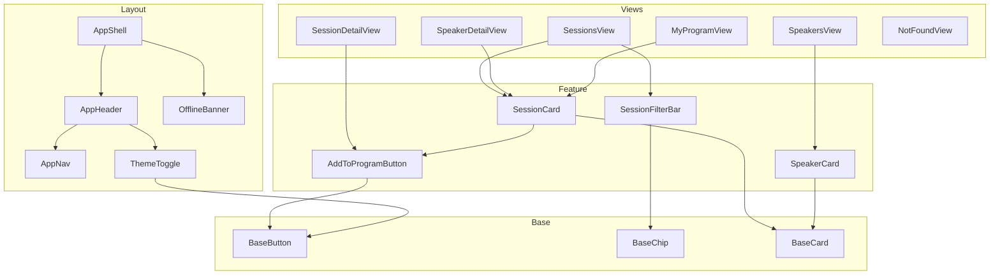

# ADR B: Komponenten- und Ordnerstruktur

- **Status:** Entwurf
- **Datum:** 2026-10-17
- **Verantwortlichkeit:** Maurice Schmidt (Verschriftlichung), gemeinsam entschieden mit Sam Lechner


## Kontext

Wir bauen eine Konferenz-Plattform für die fiktive zweitägige Web-Frontend-Konferenz „FrontendNow“. Pflichtfunktionen sind Session-Suche und -Filter, Speaker-Profile, ein persönlicher Zeitplan („Mein Programm“), Offline-Verfügbarkeit und Dark Mode. Datenquelle ist die statische, schreibgeschützte `conference-data.json` (Sessions, Speaker, Tracks, Räume); es gibt kein Backend.

Das Projekt umfasst voraussichtlich 6 Views und gut ein Dutzend Komponenten und wird von zwei Personen entwickelt. Es wächst über vier Schritte: In Schritt 2 kommt die Rendering-Strategie dazu, in Schritt 3 PWA und Offline-Logik. Die Struktur muss diese Erweiterungen aufnehmen, ohne umgebaut zu werden.

Dieses ADR geht von Vue 3 + Vite + vue-router aus (siehe ADR D). Bei Nuxt wären Teile der Struktur vorgegeben: Seiten lägen in `pages/` und würden automatisch zu Routen, Composables und Komponenten würden automatisch importiert.


Die Struktur soll bei folgenden Themen unterstützen:

1. **Auffindbarkeit:** Jede Datei soll sich ohne Suchen finden lassen.
2. **Wiederverwendung:** Komponenten sollen in mehreren Views einsetzbar sein, ohne dass Code dupliziert wird.
3. **Erweiterbarkeit:** Bis E8 sollen neue Funktionen (z. B. Offline-Hinweis, Theme-Umschalter) hinzukommen können, ohne bestehende Ordner umzubauen.
4. **Paralleles Arbeiten:** Zwei Personen sollen gleichzeitig arbeiten können, ohne sich ständig in denselben Dateien zu begegnen.


## Optionen

### Option 1: Ordnung nach Dateiart (technische Schichten)

Dateien werden nach ihrer Rolle sortiert: `components/` (unterteilt in `base/`, `feature/`, `layout/`), `composables/`, `stores/`, `views/`.

| | |
| --- | --- |
| **Vorteile** | Bei der Projektgröße ist jeder Ordner schnell überblickt (Auffindbarkeit). Geteilte Bausteine wie `SessionCard` haben einen eindeutigen Platz (Wiederverwendung). Die in der Angabe geforderten Schichten Base, Feature und Layout lassen sich direkt als Unterordner abbilden. |
| **Nachteile** | Was zu einem Feature gehört (z. B. Filter), verteilt sich auf mehrere Ordner (`components/feature/`, `composables/`, `views/`). Bei starkem Wachstum wird `components/feature/` voll. |

### Option 2: Ordnung nach Feature

Jedes Feature bekommt einen eigenen Ordner mit allem, was dazugehört, z. B. `features/sessions/` (Komponenten, Composables, View) und `features/program/`. Geteilte Bausteine liegen in `shared/`.

| | |
| --- | --- |
| **Vorteile** | Alles zu einem Feature liegt an einem Ort. Zwei Personen können getrennt an zwei Features arbeiten (paralleles Arbeiten). Skaliert gut, wenn ein Feature sehr groß wird. |
| **Nachteile** | Unsere Features überschneiden sich stark: `SessionCard` wird in Sessions, Speaker-Detail und Mein Programm gebraucht und landet in `shared/`. Bei unserer Größe würde ein großer Teil des Codes in `shared/` liegen, die Feature-Trennung wäre also kaum sauber. Mehr Ordnerebenen für wenig Inhalt. |


## Entscheidung

Wir entscheiden uns für **Option 1**, weil bei der Größe des Projekts jeder Ordner nach Dateiart schnell überblickt ist. Feature-Ordner lohnen sich erst, wenn ein einzelnes Feature so groß wird, dass man es getrennt pflegen will. Außerdem teilen sich unsere Features die Bausteine: Eine `SessionCard` brauchen wir in der Session-Liste, auf der Speaker-Detailseite und in „Mein Programm“. Bei Feature-Ordnern müsste sie in einen `shared/`-Ordner, und die Trennung wäre nicht sauber.

Paralleles Arbeiten (Kriterium 4) erreichen wir stattdessen über Git: eine Branch pro Thema und Absprache, wer welche Dateien bearbeitet.


### Regel für die Komponentenschichten

Eine Komponente landet in der Schicht, deren Frage sie mit „ja“ beantwortet (von oben nach unten geprüft):

| Schicht | Frage | Bekommt Daten über |
| --- | --- | --- |
| `layout/` | Bildet sie das Gerüst der App, das auf jeder Seite gleich ist (Kopf, Navigation, Rahmen)? | App-weite Composables (Theme, Online-Status) |
| `feature/` | Kennt sie die Domäne, also weiß sie, was eine Session, ein Speaker oder Mein Programm ist? | Props mit Domänen-Objekten, Store |
| `base/` | Nichts davon: Sie kennt nur Props, Slots und Events und funktioniert in jedem Projekt. | Nur Props/Slots |

Views (`views/`) sind keine wiederverwendbaren Komponenten. Sie gehören zu genau einer Route, setzen Feature- und Base-Komponenten zusammen und holen die Daten aus Composables und Store.

Abhängigkeiten zeigen nach unten (oder innerhalb derselben Schicht): `views` → `layout`/`feature` → `base`. Eine Base-Komponente importiert nie eine Feature-Komponente.


### Ordnerstruktur

```text
src/
  assets/
    data/
      conference-data.json   Datensatz (read-only)
  components/
    base/                    BaseButton, BaseChip, BaseCard
    feature/                 SessionCard, SessionFilterBar, SpeakerCard, AddToProgramButton
    layout/                  AppHeader, AppNav, AppShell, ThemeToggle, OfflineBanner
  composables/               useConferenceData, useSessionFilter, useTheme, useOnlineStatus
  stores/                    myProgram.ts (Details siehe Konzept C)
  types/                     conference.ts (Session, Speaker, Track, Room)
  views/                     SessionsView, SessionDetailView, SpeakersView,
                             SpeakerDetailView, MyProgramView, NotFoundView
  router/
    index.ts                 Routen-Definition
  styles/
    base.css                 Reset, Grundtypografie
  App.vue
  main.ts                    bindet tokens/tokens.css und styles/base.css ein
tokens/
  tokens.css                 Design Tokens (außerhalb von src/, laut Abgabestruktur)
```


### Komponentenübersicht (voraussichtlich)




### Headless-Prüfung

Wir haben für zwei zentrale Interaktionen geprüft, ob die Logik als Composable von der Darstellung getrennt werden soll.

**Session-Filterung: ja, headless als `useSessionFilter()`**

Das Composable hält die aktiven Filter (Tag, Track, Level, Speaker, Suchtext), synchronisiert sie mit den Query-Parametern der URL und liefert die gefilterte Session-Liste (`filtered`), die aktiven Filter (`activeFilters`) und `reset()`. Die Darstellung bleibt austauschbar.

Begründung:
- **Mehrere Darstellungen derselben Logik:** Am Desktop als Filterleiste, am Handy als ausklappbares Panel. Beide nutzen dasselbe Composable, die Logik wird nicht doppelt geschrieben.
- **Mehrere Verbraucher:** Filterleiste und Session-Liste brauchen denselben Zustand. Liegt er im Composable, sind beide automatisch synchron.
- **Testbarkeit:** Die Filterlogik ist reines TypeScript und lässt sich ohne Browser testen.  


**„Zum Programm hinzufügen“: nein, kein eigenes Headless-Composable**

Die Logik (hinzufügen, entfernen, prüfen ob enthalten) liegt bereits im Store für Mein Programm (Konzept C). `AddToProgramButton` ruft den Store direkt auf und zeigt den Zustand an. Ein zusätzliches Composable wie `useAddToProgram()` würde nur die Store-Funktionen weiterreichen, ohne eigene Logik. Es gibt außerdem nur eine Darstellung (einen Button), die an mehreren Stellen wiederverwendet wird. Eine Trennung brächte hier keinen Vorteil und wäre Headless als Selbstzweck.


## Konsequenzen

**Positiv**
- Neue Dateien haben einen eindeutigen Platz. Die Schichtregel entscheidet in einem Schritt, wohin eine Komponente gehört.
- Geteilte Komponenten wie `SessionCard` existieren nur einmal.
- Erweiterungen aus späteren Schritten passen ohne Umbau hinein: `OfflineBanner` und `useOnlineStatus` (Schritt 3) haben ihren Platz in `layout/` und `composables/` schon.
- Die Filterlogik ist unabhängig von der Darstellung testbar und wiederverwendbar.

**Negativ / worauf wir achten**
- Code zu einem Feature verteilt sich auf mehrere Ordner. Wer am Filter arbeitet, öffnet `composables/useSessionFilter.ts`, `components/feature/SessionFilterBar.vue` und `views/SessionsView.vue`.
- `components/feature/` kann bis E8 voll werden. Ab etwa 10 Dateien können wir es in Unterordner (`feature/session/`, `feature/speaker/`) aufteilen, ohne die Schichten zu ändern.
- Die Schichtregel muss im Code-Review geprüft werden. Eine Base-Komponente, die eine Feature-Komponente importiert, ist ein Fehler.
- Weil nicht nach Feature getrennt wird, sprechen wir vor jeder Branch ab, wer welche Dateien bearbeitet beziehungsweise können wir auch unterschiedliche Uhrzeiten festlegen, an denen wir am Projekt arbeiten.