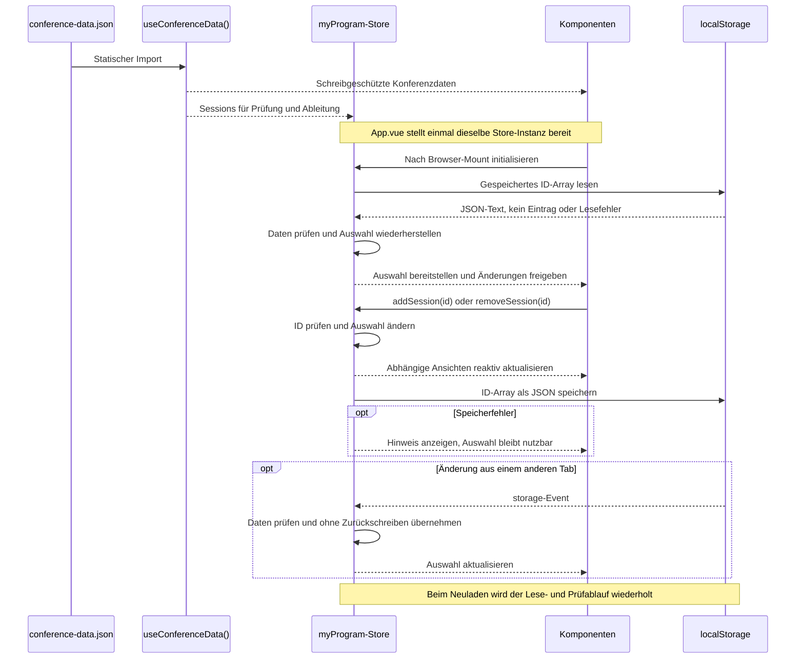

# C. State-Management-Konzept: „Mein Programm“ und conference-data.json

## Konzept

Für CouchCoding trennen wir die allgemeinen Konferenzdaten von der persönlichen Session-Auswahl. Die Oberfläche nennt diese Auswahl „Mein Couch-Programm“. Die Konferenzdaten bleiben unverändert; ein Backend und ein Login sind laut Szenario nicht vorgesehen.

Die `conference-data.json` wird statisch importiert und über `useConferenceData()` schreibgeschützt bereitgestellt. Als Ablage ist entsprechend B `src/assets/data/` vorgesehen. Der Import spart eine zusätzliche Datenanfrage; Änderungen am Datensatz benötigen dafür einen neuen Build. TypeScript-Typen in `types/conference.ts` beschreiben Konferenz, Sessions, Speaker, Tracks und Räume einschließlich der erlaubten Level und Formate. Die Beziehungen bleiben über IDs erhalten, etwa `speakerIds` und `trackId`. Filteroptionen werden aus den Daten erzeugt.

Für das persönliche Programm speichern wir ein Array eindeutiger Session-IDs, beispielsweise `["s02", "s07"]`. Vollständige Session-Objekte würden dieselben Inhalte zusätzlich speichern und könnten vom Datensatz abweichen. Ein `computed()` ermittelt aus den IDs die ausgewählten Sessions und sortiert sie nach Tag und Startzeit. Das ursprüngliche Sessions-Array bleibt dabei unverändert.

Der gemeinsame Zustand liegt wie in B vorgesehen in `stores/myProgram.ts`. Dort wird einmal pro App-Instanz ein Store mit `ref<string[]>` erzeugt. `App.vue` stellt ihn über `provide` bereit; `useMyProgram()` holt über `inject` dieselbe Instanz. `SessionCard`, `AddToProgramButton` und `MyProgramView` greifen dadurch auf dieselbe reaktive Auswahl zu. Änderungen laufen über `addSession()` und `removeSession()`; `isSelected()` prüft die Auswahl. Unbekannte IDs und doppelte Einträge werden verhindert. Komponenten erhalten schreibgeschützten Zugriff. Pinia wäre eine Alternative; für diesen kleinen Zustand reichen zunächst die Vue-Funktionen.

Die Session-Filter bleiben entsprechend B in `useSessionFilter()` und werden mit den URL-Parametern synchronisiert. Sie gehören nicht zur gespeicherten Programmauswahl. Base-Komponenten erhalten weiterhin nur Props, Slots und Events. Hinweise und Auswahlzustände verwenden die semantischen Design-Tokens aus A.

Nach dem Mounten im Browser liest der Store einmal den Schlüssel `frontendnow:2026:my-program:v1` aus `localStorage`. Dabei werden JSON-Struktur und ID-Typen geprüft, Duplikate entfernt und unbekannte IDs verworfen. Ohne Eintrag beginnt die Auswahl leer. Beschädigte Daten führen ebenfalls zu einer leeren Auswahl und einem Hinweis. Erst danach werden Änderungen freigegeben, damit die leere Startauswahl keine gespeicherten Daten überschreibt.

Nach jeder tatsächlichen Änderung wird das ID-Array als JSON gespeichert. Lese- und Schreibfehler werden abgefangen; bei einem Speicherproblem bleibt die Auswahl während der Nutzung verfügbar und ein Hinweis erscheint. Änderungen aus anderen Tabs derselben Origin übernimmt der Store über das `storage`-Event nach derselben Prüfung, ohne erneut zu speichern. Bei gleichzeitigen Änderungen gilt der zuletzt gespeicherte Stand; Änderungen können sich dabei überschreiben. Beim Neuladen werden die IDs wiederhergestellt. Das Offline-Laden der Anwendung und des Datensatzes wird später über die PWA-Erweiterung ergänzt.

## Datenfluss und Wiederherstellung

## Technische Quellen

- [Vue: Provide / Inject](https://vuejs.org/guide/components/provide-inject.html)
- [Vue: Computed Properties](https://vuejs.org/guide/essentials/computed.html)
- [MDN: localStorage](https://developer.mozilla.org/en-US/docs/Web/API/Window/localStorage)
- [MDN: storage-Event](https://developer.mozilla.org/en-US/docs/Web/API/Window/storage_event)