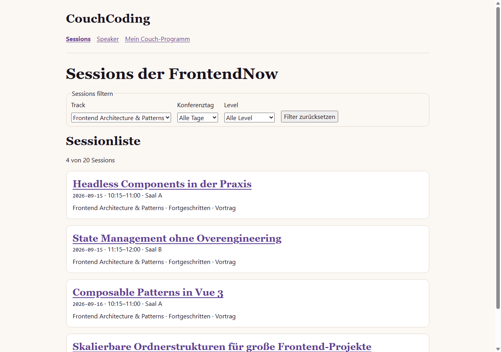

# E – Verifikationsnachweis

**Testlauf am 25. November 2026** · Sams Rechner · Produktionsbuild `c8f7c5a` · Chrome 158.0.8127.88

## Einordnung

Der Gegencheck lief auf Windows 11 Pro mit dem Produktionsbuild aus `npm run build` und Vite Preview unter `http://localhost:44173`. Für jedes Szenario startete Chrome mit einem frischen Browser-Kontext. Das Chrome DevTools Protocol schaltete die Netzverbindung für den Test-Tab ab und deaktivierte den HTTP-Cache. Die Antworten mit `fromServiceWorker: true` und `cache-storage` stammen aus dem Precache des Service Workers.

In Szenario i funktionierten der Reload der Sessionübersicht mit und ohne Filter sowie Direktaufrufe zuvor ungeöffneter Session- und Speaker-Details. In Szenario ii wurde die gespeicherte Auswahl nach dem Offline-Reload nach Datum angezeigt. Das Entfernen von `s02` blieb beim folgenden Reload erhalten. In Szenario iii zeigte Chrome beim ersten Offline-Aufruf `ERR_INTERNET_DISCONNECTED`. Ein Online-Besuch stellte den Offline-Zugriff für den folgenden Reload her.

Lighthouse 11.7.1 bestätigte die Installierbarkeitsanforderungen für Manifest und Service Worker. Diese Version enthält die PWA-Kategorie, die ab Lighthouse 12 entfiel. Chrome 158 meldete keine Manifest- oder Installierbarkeitsfehler und zeigte `sw.js` als aktiven Controller. Der Test belegt das Verhalten in Chrome auf Localhost. Eine manuelle Installation auf einem Mobilgerät, andere Browser und der Wechsel zwischen zwei deployten Versionen bleiben ungeprüft. [Lighthouse 12 – Release Notes](https://github.com/GoogleChrome/lighthouse/releases/tag/v12.0.0)

## Ergebnisse nach Szenario

| Szenario aus [D](03-entscheidungsprotokoll.md) | Befund im Chrome-Netzwerkprotokoll | Beleg |
| --- | --- | --- |
| i – Sessionübersicht und Details offline | HTTP 200 aus Cache Storage für Übersicht, Filter-URL, `/sessions/s17`, `/speakers/sp07` und `/`. | Abb. 1a und 1b |
| ii – Mein Couch-Programm offline | Beide Reloads lieferten HTTP 200 aus Cache Storage. Nach dem Entfernen blieben `s01` und `s17` in `localStorage`. | Abb. 2 |
| iii – Erster Aufruf offline | Frischer Kontext mit 0 Byte Website-Speicher. Navigation mit `ERR_INTERNET_DISCONNECTED`, nach Online-Aufruf HTTP 200 aus Cache Storage. | Abb. 3 |
| PWA-Check für den Einstieg aus i–iii | Start-URL `/sessions`, Modus `standalone`, 0 Manifest- und 0 Installierbarkeitsfehler sowie aktiver `sw.js` mit Scope `/`. Lighthouse-Prüfung „Installable“ bestanden. | Abb. 4 |

Das [Chrome-Netzwerkprotokoll](assets/chrome-results.json) enthält die Messwerte je Szenario, die Manifest-Daten und die Liste der 53 Precache-Einträge. Die Screenshots zeigen den Seiteninhalt in dem jeweiligen Testzustand.

### Abb. 1a – Sessionfilter nach dem Offline-Reload

### Abb. 1b – Zuvor ungeöffnetes Speakerprofil offline

### Abb. 2 – Persönliches Programm nach Entfernen und Offline-Reload

### Abb. 3 – Erster Aufruf ohne Verbindung

### Abb. 4 – Lighthouse PWA-Audit

