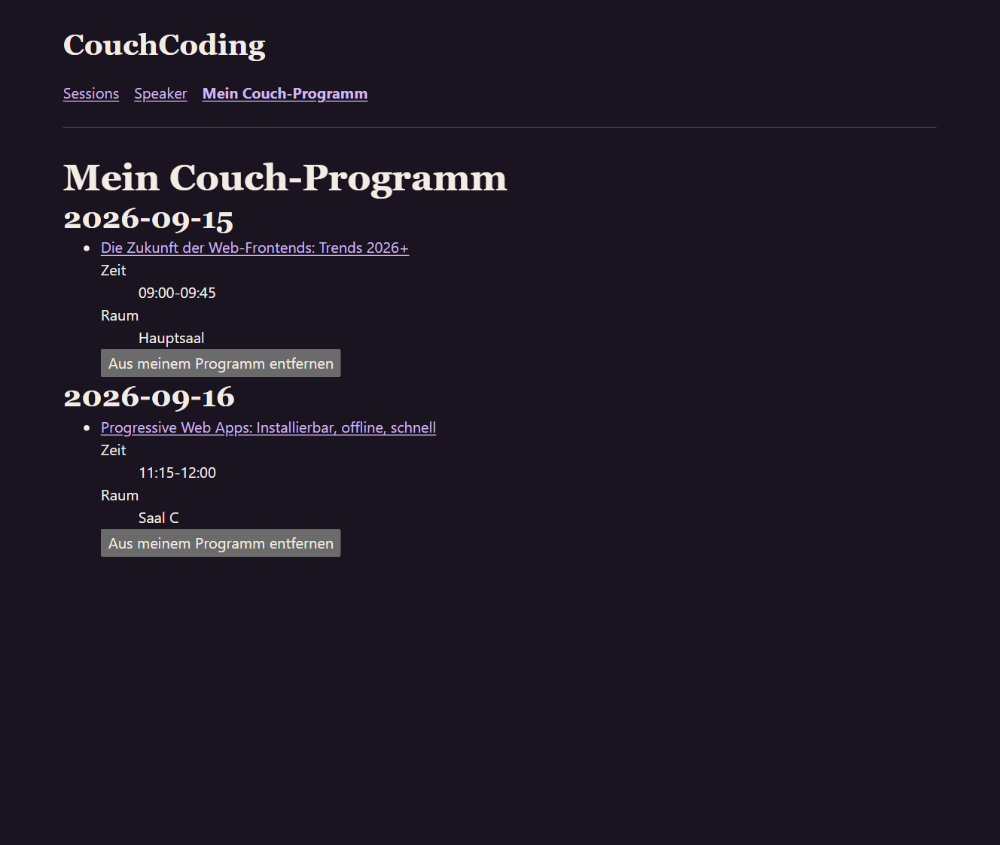
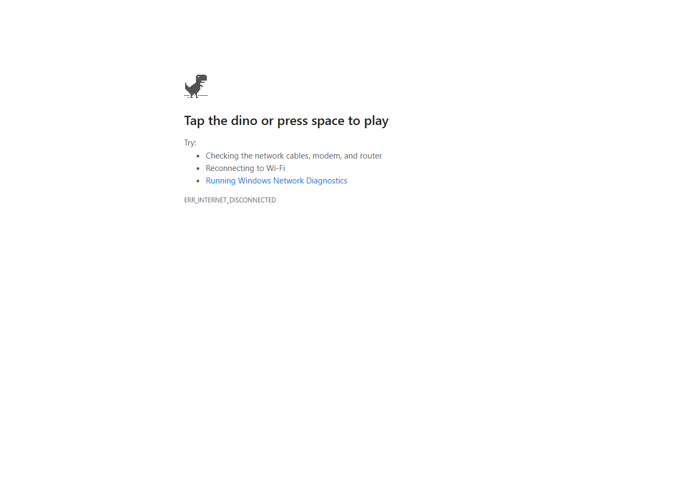
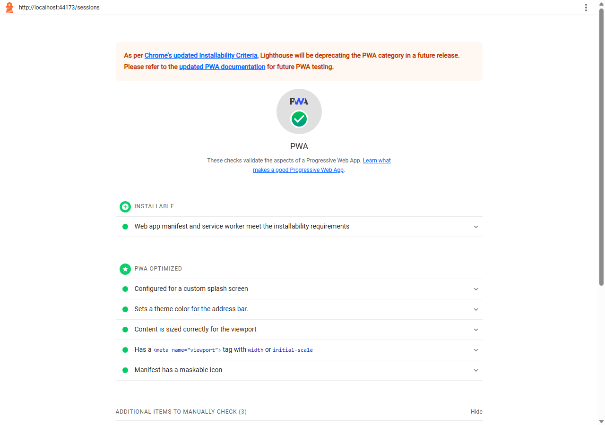

# E – Verifikationsnachweis

**Testlauf am 25. November 2026** · Sams Rechner · Produktionsbuild `c8f7c5a` · Chrome 158.0.8127.88

## Einordnung

Ich habe die drei Szenarien mit dem Produktionsbuild auf meinem Windows-Rechner erneut getestet. Meine Ergebnisse stimmen mit dem dokumentierten Chrome-Lauf unter `http://localhost:44173` überein. Dort startete jedes Szenario mit einem frischen Browser-Kontext. Das Chrome DevTools Protocol schaltete den Test-Tab offline und deaktivierte den HTTP-Cache. Das Netzwerkprotokoll zeigt, welche Antworten der Service Worker aus dem Precache geliefert hat.

Ich konnte die Sessionübersicht mit und ohne Filter offline neu laden. Auch die zuvor ungeöffneten Detailseiten zur Session `s17` und zum Speaker `sp07` waren erreichbar. In „Mein Couch-Programm“ habe ich `s02` entfernt. Nach dem Neuladen fehlte die Session weiterhin in der Auswahl. Beim ersten Aufruf ohne Verbindung erschien `ERR_INTERNET_DISCONNECTED`. Nach einem Online-Aufruf lud die Übersicht beim nächsten Offline-Reload.

Zum Nachweis gehört der Bericht aus Lighthouse 11.7.1. Diese Version hat noch die PWA-Kategorie und bestätigte die Installierbarkeitsanforderungen für Manifest und Service Worker. Chrome 158 meldete keine Fehler beim Manifest oder bei der Installierbarkeit und zeigte `sw.js` als aktiven Controller. Der Nachweis deckt Chrome auf Localhost ab. Eine Installation auf dem Handy, andere Browser und ein Update zwischen zwei deployten Versionen bleiben offen. [Lighthouse 12 – Release Notes](https://github.com/GoogleChrome/lighthouse/releases/tag/v12.0.0)

## Ergebnisse nach Szenario

| Szenario aus [D](03-entscheidungsprotokoll.md) | Befund im Chrome-Netzwerkprotokoll | Beleg |
| --- | --- | --- |
| i – Sessionübersicht und Details offline | HTTP 200 aus Cache Storage für Übersicht, Filter-URL, `/sessions/s17`, `/speakers/sp07` und `/`. | Abb. 1a und 1b |
| ii – Mein Couch-Programm offline | Beide Reloads lieferten HTTP 200 aus Cache Storage. Nach dem Entfernen blieben `s01` und `s17` in `localStorage`. | Abb. 2 |
| iii – Erster Aufruf offline | Frischer Kontext mit 0 Byte Website-Speicher. Navigation mit `ERR_INTERNET_DISCONNECTED`, nach Online-Aufruf HTTP 200 aus Cache Storage. | Abb. 3 |
| PWA-Check für den Einstieg aus i–iii | Start-URL `/sessions`, Modus `standalone`, 0 Manifest- und 0 Installierbarkeitsfehler sowie aktiver `sw.js` mit Scope `/`. Lighthouse-Prüfung „Installable“ bestanden. | Abb. 4 |

Für die App-Aufnahmen emulierte Chrome die Systemeinstellung „Dunkel“. Bei allen drei Aufnahmen lieferte der Service Worker auch das CSS-Bundle aus Cache Storage. Das Protokoll enthält die Messwerte, die Manifest-Daten und die Liste der 53 Precache-Einträge. [Chrome-Netzwerkprotokoll](assets/chrome-results.json)

### Abb. 1a – Sessionfilter nach dem Offline-Reload

### Abb. 1b – Zuvor ungeöffnetes Speakerprofil offline

### Abb. 2 – Persönliches Programm nach Entfernen und Offline-Reload

### Abb. 3 – Erster Aufruf ohne Verbindung

### Abb. 4 – Lighthouse PWA-Audit

