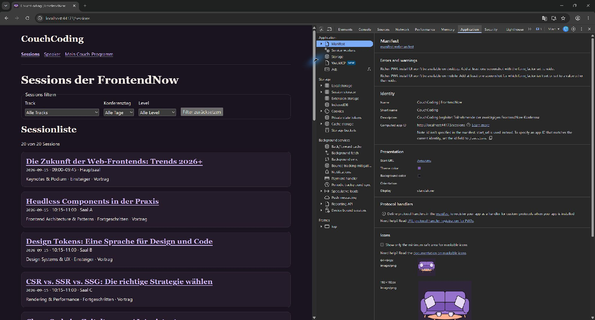
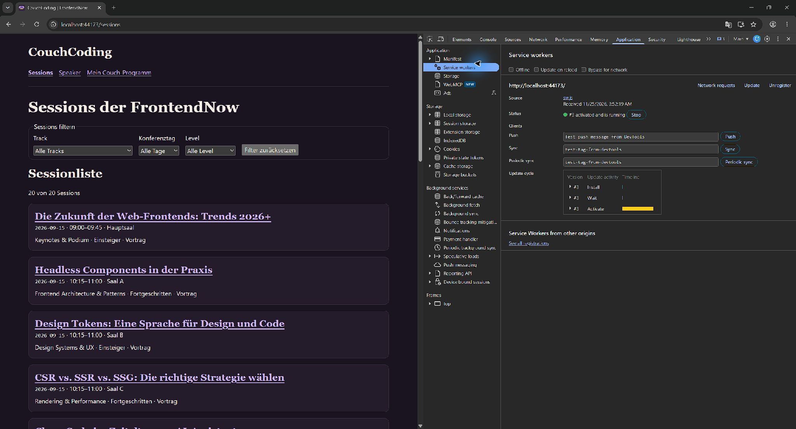
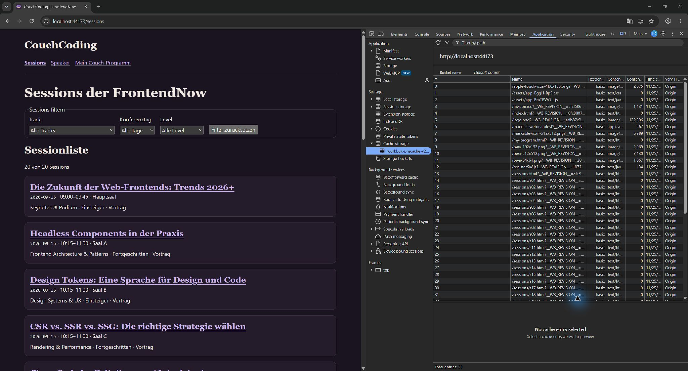
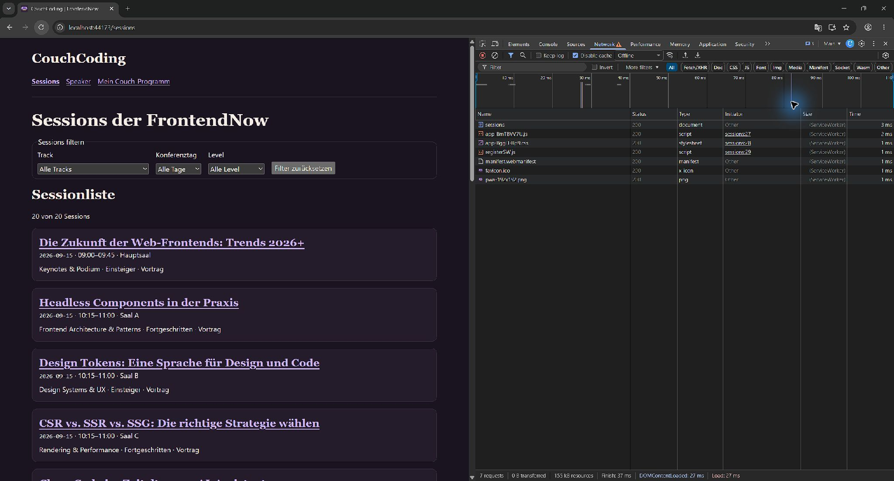
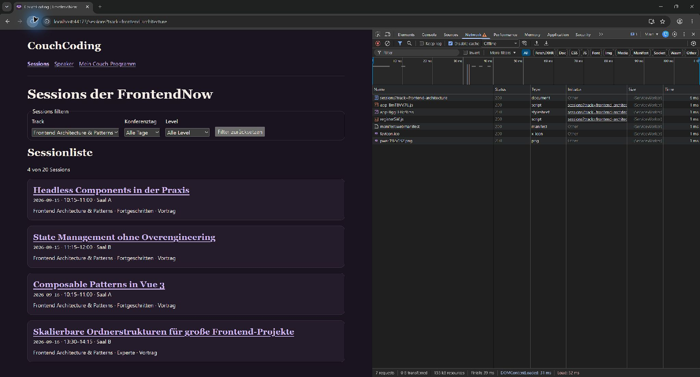
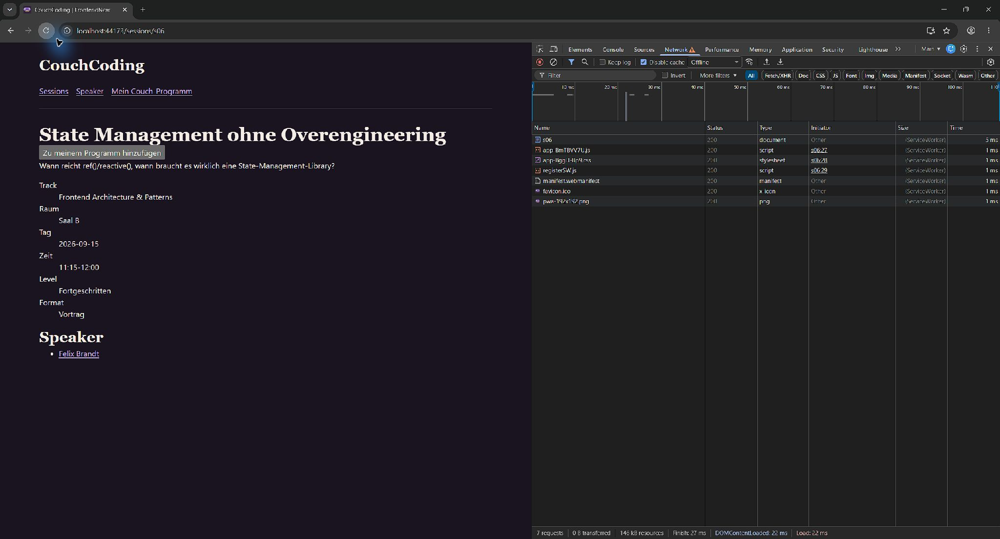
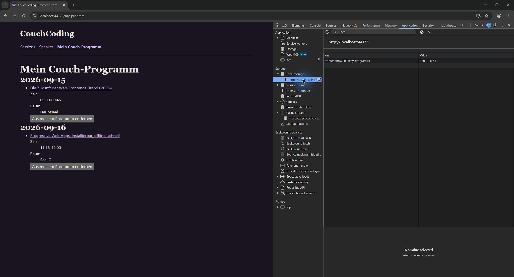
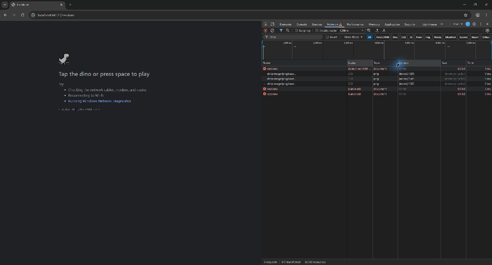
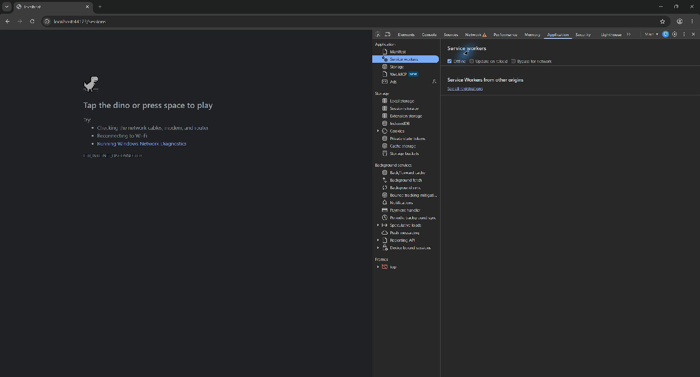

# E – Verifikationsnachweis

**DevTools-Aufnahmen vom 25. November 2026** · Sams Rechner · Produktionsbuild `bf607c5` · Chrome 158.0.8127.88

## Einordnung

Maurice und ich haben die drei Szenarien unabhängig auf zwei Windows-Rechnern getestet. Wir haben den Produktionsbuild mit `npm run build` erstellt und mit Vite Preview geöffnet. Die DevTools-Aufnahmen zeigen die Vorschau unter `http://localhost:44173`. Für i und ii war der Service Worker nach einem Online-Besuch bereits aktiv. Für iii wurde ein frisches Chrome-Profil vor dem ersten Aufruf auf „Offline“ gestellt.

Die Sessionübersicht lud offline mit und ohne Filter. Das Network-Panel zeigte „(ServiceWorker)“ für HTML, JavaScript und CSS bei ausgeschaltetem HTTP-Cache. Auch zuvor ungeöffnete Detailseiten waren erreichbar. Im persönlichen Programm blieb `s02` nach dem Entfernen und Neuladen aus der Auswahl gelöscht. Beim Erstbesuch ohne Verbindung erschien `ERR_INTERNET_DISCONNECTED`. Nach einem Online-Aufruf funktionierte der nächste Offline-Reload.

Seit Lighthouse 12 gibt es keine PWA-Kategorie mehr, daher belegen die Aufnahmen unter DevTools → Application das Manifest, den Service Worker und den Precache. Der Bericht aus Lighthouse 11.7.1 ergänzt den Installierbarkeitscheck. DevTools simuliert eine unterbrochene Verbindung im Browser. Ein echter Flugmodus, die Installation auf einem Mobilgerät und der Wechsel zwischen zwei Deployments wurden nicht getestet. [Lighthouse 12 – Release Notes](https://github.com/GoogleChrome/lighthouse/releases/tag/v12.0.0)

## Ergebnisse nach Szenario

| Prüfung | Beobachtung | Beleg |
| --- | --- | --- |
| A und C – PWA-Grundgerüst und Precache | Start-URL `/sessions`, Modus `standalone`, aktiver Service Worker und 53 Einträge in Cache Storage. | Abb. 1–3 und 10 |
| i – Sessionübersicht und Details offline | Übersicht, Filter-URL und Sessiondetail laden mit HTTP 200 vom Service Worker. | Abb. 4–6 |
| ii – Mein Couch-Programm offline | Nach Entfernen und Reload stehen `s01` und `s17` weiterhin in der Ansicht und in Local Storage. | Abb. 7 |
| iii – Erster Aufruf offline | Chrome zeigt `ERR_INTERNET_DISCONNECTED` und listet für das frische Profil keinen Service Worker. | Abb. 8–9 |

Das frühere Netzwerkprotokoll zum gleichen Anwendungsstand enthält zusätzlich die Antworten für die Startseite, `/sessions/s17` und `/speakers/sp07` sowie die Liste aller 53 Precache-Einträge. [Entscheidungsprotokoll](03-entscheidungsprotokoll.md) · [Chrome-Netzwerkprotokoll](assets/chrome-results.json)

### Abb. 1 – Manifest

Unter „Application → Manifest“ sind App-Name, Start-URL, Farben und Icons sichtbar, zusammen mit zwei Hinweisen auf optionale Screenshots für den erweiterten Installationsdialog.

### Abb. 2 – Aktiver Service Worker

Der Service Worker `sw.js` steht nach dem Online-Aufruf auf „activated and is running“, während „Update on reload“ ausgeschaltet ist.

### Abb. 3 – Workbox-Precache

Cache Storage zeigt 53 Einträge, darunter das Manifest, das JS- und CSS-Bundle sowie vorgerenderte Sessionseiten.

### Abb. 4 – Sessionübersicht offline

In Szenario i zeigt das Network-Panel „Offline“ und für die Übersicht sowie die statischen Dateien „(ServiceWorker)“ in der Spalte „Size“.

### Abb. 5 – Gefilterte Übersicht nach dem Offline-Reload

In Szenario i bleiben nach dem Offline-Reload der URL mit `track=frontend-architecture` vier von 20 Sessions sichtbar.

### Abb. 6 – Sessiondetail nach dem Offline-Reload

In Szenario i liefert der Service Worker die Detailseite `/sessions/s06` auch nach einem Offline-Reload mit HTTP 200.

### Abb. 7 – Persönliches Programm und Local Storage

In Szenario ii sind nach dem Entfernen von `s02` und dem Offline-Reload dieselben zwei Sessions im Programm und in Local Storage sichtbar.

### Abb. 8 – Erster Aufruf ohne Netz

In Szenario iii schlägt der erste Aufruf von `/sessions` bei aktiviertem Offline-Modus mit `ERR_INTERNET_DISCONNECTED` fehl.

### Abb. 9 – Service Workers beim Erstbesuch

In Szenario iii zeigt „Application → Service Workers“ nach dem fehlgeschlagenen Erstaufruf keine Registrierung.

### Abb. 10 – Ergänzender Lighthouse-PWA-Bericht

Lighthouse 11.7.1 meldet für Manifest und Service Worker eine bestandene Installierbarkeitsprüfung.
